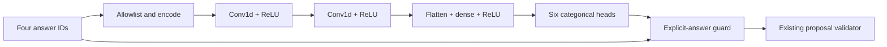

# Short interview → CNN → UI proposal

Status: **connected to the local storefront for prototype testing**. This trains and tests an actual convolutional neural network. The four-question sheet runs exported model weights in the browser; Apply creates one reversible store change. See the [storefront walkthrough](../../src/lib/mobile/README.md). Real shopper validity remains untested.

## The interview

One tap per question. Every question is optional. Language stays in the existing language control. Do not ask age, gender, income, or assign a personality label. Completion time has not been measured with shoppers.

| Question                      | Answers                                            |
| ----------------------------- | -------------------------------------------------- |
| **What are you here to do?**  | Browse · Compare · Help me choose · Find a gift    |
| **What helps you choose?**    | Pictures · Specs · Buyer reviews · Short summaries |
| **What matters most?**        | Value · Performance · Durability · Buyer ratings   |
| **How should the page feel?** | Balanced · Compact · More space · Large text       |

Thai version:

| คำถาม                       | คำตอบ                                          |
| --------------------------- | ---------------------------------------------- |
| **วันนี้อยากเลือกซื้อแบบไหน?**    | ดูก่อน · เปรียบเทียบ · ช่วยคัดให้ · หาของขวัญ          |
| **ดูอะไรแล้วตัดสินใจง่ายขึ้น?**    | รูปสินค้า · สเปก · รีวิวผู้ซื้อ · สรุปสั้น ๆ               |
| **ให้ความสำคัญกับอะไรมากที่สุด?** | ความคุ้มค่า · ประสิทธิภาพ · ความทนทาน · คะแนนจากผู้ซื้อ |
| **อยากให้อ่านหน้าแบบไหน?**     | พอดี ๆ · กระชับ · เว้นระยะมากขึ้น · ตัวอักษรใหญ่       |

Use “Skip — keep my current settings” / “ข้าม — ใช้การตั้งค่าปัจจุบัน”. The reusable bilingual definitions are in [interview.json](interview.json).

## What the stack actually does



| Layer             | Shape for one interview       | Meaning                                                                                                |
| ----------------- | ----------------------------- | ------------------------------------------------------------------------------------------------------ |
| Input             | 1 × 20 × 4                    | Four question positions; sixteen question-specific answer channels and four question-identity channels |
| Conv1d + ReLU     | 1 × 16 × 4                    | Learned local combinations; kernel width three, padding one                                            |
| Conv1d + ReLU     | 1 × 24 × 4                    | Learned combinations across questions; kernel width three, padding one                                 |
| Flatten           | 1 × 96                        | Preserves question position                                                                            |
| Dense + ReLU      | 1 × 32                        | Shared representation                                                                                  |
| Categorical heads | 4 / 3 / 3 / 4 / 4 / 4 classes | Theme / layout / density / details recipe / sections recipe / priority                                 |

The network has **5,982 trainable parameters**. These are real PyTorch Conv1d layers with backpropagation, not rule functions labeled as CNN layers. Hidden features are not interpreted as personality traits. Raw activation values and head probabilities for three held-out examples are saved in [results/report.json](results/report.json).

The four questions have a fixed semantic order, not a natural spatial structure. Convolution is an experimental assumption here. A successful result demonstrates that the architecture can reproduce this small authored mapping; it does not establish that convolution is the best architecture for preferences. Compare a small MLP and a tree model if real outcome data becomes available. [Conv1d documentation](https://docs.pytorch.org/docs/2.15/generated/torch.nn.Conv1d.html); [tabular-learning benchmark](https://proceedings.neurips.cc/paper_files/paper/2022/hash/0378c7692da36807bdec87ab043cdadc-Abstract-Datasets_and_Benchmarks.html).

## Test design and observed result

Hypothesis: a small CNN can reproduce all six authored UI targets on unseen combinations of previously observed answers. Predeclared engineering criterion: at least 95% exact agreement across all heads on held-out combinations. This is a feasibility criterion, not a shopper-success criterion.

- Dataset: all **256** complete answer combinations, each occurring once. Labels are design rules in `rule_labels`, not interviews collected from people.
- Fixed combination split: **154 train / 51 validation / 51 test**. No combination appears in multiple splits. Individual answer options appear in multiple splits intentionally.
- Three initialization seeds: **7, 17, 29**, with the same split. These are training repeats, not independent populations.
- Training: 200 full-batch Adam steps, learning rate 0.01, summed categorical cross-entropy. Select checkpoint by validation loss only. Use the predeclared first seed for exported examples.
- Evaluate **raw network outputs before the explicit-answer guard**; otherwise deterministic overrides would conceal model errors.

| Baseline / model                     | All six heads correct on held-out combinations |
| ------------------------------------ | ---------------------------------------------- |
| Per-head majority from training data | 0 / 51                                         |
| Authored rules                       | 51 / 51, by construction                       |
| CNN seed 7                           | 51 / 51                                        |
| CNN seed 17                          | 51 / 51                                        |
| CNN seed 29                          | 51 / 51                                        |

Every individual head also scored 100% on this split. No held-out failures occurred. This tests recombination within the authored domain, not unseen answer options, free text, new languages, real shopper preferences, or conversion rates. No claim of calibrated confidence is made. The 0.8 theme threshold is a prototype gate, not a validated probability of correctness.

**Decision:** retain direct rules as the useful baseline. The CNN has demonstrated feasibility, not an advantage. It is available for local interactive inspection at the user's request; do not claim production effectiveness based on this result.

## Example output

Held-out answers: **Compare → Pictures → Value → Large text**.

Raw CNN output:

```json
{
	"theme": "large-print",
	"layout": "table",
	"density": "spacious",
	"details": "photos",
	"sections": "compare",
	"priority": "value"
}
```

Decoded proposal: a large-print comparison view with spacious spacing, image/price/rating/shop/shipping details, the existing “What matters” and “Products” sections, and value first. Section and detail names expand from fixed recipes. Ranking itself remains the existing deterministic catalog function. Large text does not imply Thai, an age, or a restricted shortlist.

## Guard and application boundary

- The model sees only allowlisted answer IDs, never product facts, prices, personal identifiers, transcripts, or the catalog.
- Each valid answer independently survives corrupt siblings. Unknown fields are logged generically without reflecting hostile text.
- The original Python CLI uses direct answers for layout, density, details, sections and priorities. The connected browser now decodes the trained layout, details and section heads into allowlisted presentation recipes; reading settings and symbolic priorities remain direct choices. Invalid heads fall back individually.
- In the original Python CLI, theme is the only optional inferred setting. Existing explicit theme locks win; an explicit large-text answer wins over any prediction. A model cannot infer large print on its own.
- Missing answers bypass the CNN and change only answered fields. A missing model, invalid head shape, nonfinite output, low score, or inference failure leaves the direct answer path available. The CLI needs the Python dependencies installed; no network or model service is used during inference.
- Output is an allowlisted plan proposal with symbolic priority values (`first` / `off`), no prose, markup, numbers, or product IDs. The existing TypeScript validator supplies the guarded reply and numeric ranking weights.
- The connected local storefront uses one atomic Apply action, a change receipt, removable preferences, Undo and Reset. Closing the interview cancels the draft. Explicit theme locks survive later CNN suggestions. `predict.py` itself still only prints proposals.

Automated checks: **7 Python tests**, including all **625** complete/partial answer combinations, gradient flow through both convolution layers, bilingual definitions, hostile model output and model failure; **3 TypeScript tests**, including all 256 generated proposals across four starting themes and both locales, deterministic ranking, unchanged catalog data, and a poisoned proposal.

These original experiment checks are engine checks. The connected storefront adds browser/PyTorch logit parity over all 256 combinations, state-boundary tests, and phone/laptop browser journeys in Thai and English. See `preview/interview.e2e.ts`. This is not live-agent, optimizer, or full product-journey certification.

## Why this does not identify a billion person types

Four questions with four answers yield **4⁴ = 256 complete response patterns**, or eight bits of information. Adding Skip creates 625 input patterns, but missing answers do not reveal more about a shopper. To distinguish a billion states using four-choice questions alone would require at least fifteen fully answered questions: **4¹⁵ = 1,073,741,824**.

The wider interface can have many more possible configurations because its components combine independently. That design space is not the number of person types established by this interview. Start with these few preferences, then let shoppers explicitly refine individual parts when needed. Avoid adding questions just to increase the combination count.

## Reproduce and inspect

From this directory, with Python 3.11 or newer:

```sh
python3 -m venv .venv
.venv/bin/pip install -r requirements.txt
.venv/bin/python run.py
.venv/bin/python export_browser.py
.venv/bin/python -m unittest -v
.venv/bin/python predict.py '{"goal":"compare","evidence":"photos","priority":"value","reading":"large"}'
```

From the repository root:

```sh
npx vitest run --project server src/lib/personalization/interview-cnn.spec.ts
```

`run.py` saves the exact split, environment, loss histories, metrics, activations, head probabilities, and generated application fixtures. It also saves local `results/model.pt` weights (ignored by Git); rerun training after a fresh checkout. `predict.py` uses the rules fallback if the checkpoint is absent. Add `--lock-theme` to preserve an existing explicit theme. Committed result JSON allows application boundary checks without installing Python dependencies.

`export_browser.py` writes trained weights to `src/lib/personalization/cnn-weights.json` and PyTorch reference logits to `results/browser-reference.json`. Run it after retraining to keep the browser model synchronized. The browser inference uses plain TypeScript and fixed-size loops, with no third-party runtime ML dependency. It computes all heads, then applies layout, details, sections and unlocked theme predictions. Explicit reading settings and theme locks remain protected. Browser model scores are not shown as calibrated probabilities.

Dependency decision: **accepted for the training experiment** — PyTorch supplies tested convolution, autograd, optimization, and checkpoint handling. It is not added to the web application dependencies. Training uses CPU, one thread, and deterministic algorithms; execution time is environment-dependent.

## Open decisions

| Status   | Decision / concern                              | Reason                                                                                                      |
| -------- | ----------------------------------------------- | ----------------------------------------------------------------------------------------------------------- |
| Accepted | Four optional bilingual questions               | Collect actionable preferences without demographic stereotypes                                              |
| Accepted | Synthetic CNN feasibility test                  | Verify shapes, learning, outputs, and the existing application boundary before collecting data              |
| Accepted | Browser CNN selects layout, details and sections | Make presentation predictions visible through the shared shelf; retain catalog facts and direct fallback |
| Proposed | Timed shopper pilot against the direct controls | Measure completion, skips, corrections, task success, and whether any model improves the experience         |
| Accepted | Local storefront integration | The user requested interactive inspection; Apply, chips, Undo and Reset are connected and tested |
| Dropped  | Billion-person-type claim                       | Response count and configuration count cannot establish distinct people or preference accuracy              |
| Resolved | Model errors erase explicit choices             | Direct-answer guard and failure fallback are tested                                                         |
| Open     | Real preference validity                        | No consented shopper dataset or observed UX outcomes exists in this experiment                              |

For a later pilot, record only consented answer IDs, explicit corrections and task outcomes. Split evaluations by shopper, not repeated sessions from the same person. Set success criteria before viewing the results. A CNN trained on a rules-generated target should never be presented as evidence about people.
