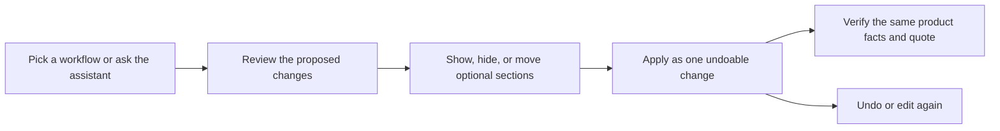

# Shopping workflows and responsive customization

**Status** Proposed. This brief builds on the [shopper hypotheses and measurement plan](milestone-1-personas-and-measurement.md) and the [approved two-shopper demo](../docs/superpowers/specs/2026-11-21-two-shopper-design.md). The examples below use the simulated catalog. Their usability benefits are hypotheses to test with shoppers.

## What to build first

Add **Edit view** to the receipt storefront. Offer a small set of shopping workflows, each an editable starting layout. Show the order of the optional sections before applying a workflow. Let the shopper enable or hide a section and move it up or down. Keep Products visible at the end. Apply the edit once and make it one step in Undo. This gives shoppers a way to control the same view whether they start from a preset, a chat request, or a direct edit.

| Starting workflow   | Starting view                                                                                              | Shopper can adjust                                                                                        |
| ------------------- | ---------------------------------------------------------------------------------------------------------- | --------------------------------------------------------------------------------------------------------- |
| Compare specs       | Start with What matters and a spec-first product table. Preserve the current query and category.           | Raise the most relevant spec rows, choose a readable layout, and open a listing for the source.           |
| Shop for family     | Top picks, What matters, Best deal, and Share with family. Offer large text and Thai as explicit settings. | Keep or remove each optional section, move the deal above the guide, or switch language.                  |
| Check the best deal | Put the optimizer receipt first when a matching product is selected, then keep the product list available. | Open the voucher breakdown or pick another listed product. Compute the new quote from the same optimizer. |

Use the existing section library and plan fields. A workflow selection changes presentation. Selecting a quote target and ranking products continue through their existing deterministic paths. A temporarily empty section can remain enabled in the editor and return when the catalog has something to show. The local live model currently proposes theme, layout, density and language. Add suggestions for optional section IDs only after the shared validator and explicit-order tests are integrated. [Product and plan rules](../guidelines/PERSONALIZATION.md)

For the first prototype, use bilingual **Move up** and **Move down** buttons. Add drag-and-drop after the buttons pass keyboard, tap and focus tests. Both gestures should dispatch the same action. Preserve focus on the item moved, and announce its new position in the section list. Disable movement at the boundaries. W3C guidance calls for a single-pointer alternative for operations that use dragging. [WCAG technique G219](https://www.w3.org/WAI/WCAG22/Techniques/general/G219)

## Additional ideas in priority order

| Idea and status                                                                | Interaction                                                                                                                                                                                                                                                                                | Evidence and bounds                                                                                                                                                                                                                                                                                                                         |
| ------------------------------------------------------------------------------ | ------------------------------------------------------------------------------------------------------------------------------------------------------------------------------------------------------------------------------------------------------------------------------------------ | ------------------------------------------------------------------------------------------------------------------------------------------------------------------------------------------------------------------------------------------------------------------------------------------------------------------------------------------- |
| **Responsive sections** · Proposed for the first prototype                     | Use the same components in the wide storefront, narrower compare pane and phone. Wide spec groups can sit beside the product identity. On a phone, use vertically stacked receipt rows and disclose secondary groups. Keep section labels and the selected product readable while editing. | Base reflow on the section's available width. A pane can be narrow on a desktop. Keep all information reachable at narrow widths and keep data-table scrolling within the table when needed. [W3C container queries](https://www.w3.org/TR/css-contain-3/), [WCAG reflow guidance](https://www.w3.org/WAI/WCAG22/Understanding/reflow.html) |
| **Trace the same product across views** · Proposed for the demo if time allows | Let the shopper click a shared cooker to locate it in both layouts, then inspect its price and capacity in each locale. On phones, align the two receipt rows vertically.                                                                                                                  | Use an existing matching product ID and `FactValue`. Only show the verification stamp after comparing both rendered values. Test one filtered-out product to make the boundary visible. [DynamicShopper proof rules](../guidelines/TRUST-AND-PROOF.md)                                                                                      |
| **Choose which specs come first** · Proposed after workflows                   | Let shoppers move relevant spec rows to the top, for example capacity and warranty on cookers. Provide a short, maintained explanation of each spec. Add a differences-only toggle for comparisons between different products.                                                             | Format values from the catalog. Keep shared facts visible in the cross-view audit and keep the full spec list reachable. Baymard found that identical rows can make product differences harder to scan. [Comparison usability study](https://baymard.com/research-articles/user-friendly-comparison-tools)                                  |
| **Review larger assistant changes** · Proposed after workflows                 | For a suggested section reorder, show a short review slip with the sections to add, move or hide. Let shoppers apply or dismiss it and keep their explicit choices. Leave simple actions such as changing text size immediately reversible.                                                | Derive the slip locally from the validated diff. Research on human–AI interaction recommends efficient correction, dismissal and explanations for system behavior. [Amershi et al., CHI 2019](https://doi.org/10.1145/3290605.3300233)                                                                                                      |
| **Reuse a workflow** · Proposed after release                                  | Save a small set of local-only shopping layouts, or share an approved layout with family.                                                                                                                                                                                                  | The current share link handles presentation settings. Any future section-order payload needs an allowlist, a size limit and a version before it crosses a browser boundary. Preserve the ability to open existing links. [Current sharing rules](../guidelines/PERSONALIZATION.md#sharing-a-store)                                          |
| **Generated buttons, markup or styling** · Dropped                             | Offer reviewed button actions, sections and theme options for customization.                                                                                                                                                                                                               | A fixed component library keeps facts, keyboard behavior and rendering independently verifiable. [Storefront rules](../AGENTS.md)                                                                                                                                                                                                           |

## Team workflow

1. **Owner 2 and Owner 4 agree on the edit contract.** Use the existing `Plan.sections` field and one shared fixture for preset apply, a direct section move, undo and a delayed model suggestion. Keep Products present and remove duplicate or unknown section IDs. Get the existing personalization contract suite and type check green on the integration baseline.
2. **Owner 3 integrates the existing preferences and section components.** Start from the [storefront PR](https://github.com/DynamicShopperInShopee/DynamicShopper/pull/7). Sync `main` and preserve the mobile listing changes and receipt entry point. Only after the one renderer is wired, add the editor controls in its preferences area. Use that renderer for the live view and proof.
3. **Owner 1 verifies facts and deals.** Assert that the shared cooker has the same raw price and capacity before and after reordering. Open identical optimizer receipts from the same basket, clock and coin balance. Keep the existing voucher-expiry and undo regressions in the combined run.
4. **Owner 4 rehearses and releases.** Check the public entry, receipt route, no-key/offline operation, remote preview result and actual served commit. Each owner commits and pushes to their established branch. Land reviewed contract and consumer changes separately with their docs and tests. Re-run the affected suites on the combined tree before merge.

## Acceptance and demo

- On a 390 × 844 phone and a 1440 × 900 laptop, start on the same cooker search. Select **Shop for family**, move Best deal above What matters and undo. Preserve the initial query, category, focused product and product facts.
- Open the two shopper views and verify the anchor cooker's raw price and capacity through the same proof surfaces. When the basket and timing match, verify equal receipt totals. One failed field withdraws the stamp.
- Test Thai and English across the four themes, keyboard, touch, reduced motion, large-print sizes, and reflow at 320 CSS px. Apply and Undo must remain reachable without dragging. An explicit section order survives delayed model responses and works with the connection off.
- Rehearse the first two steps with the existing keyless storefront before adding new scope. Observe whether a shopper can locate the shared fact, explain the difference between the two views, and restore their previous layout unaided. Record completion and errors without capturing raw chats, customer identities or inferred conversion. [Measurement plan](milestone-1-personas-and-measurement.md#prototype-measurement-baseline)

For a usability check, have volunteers try the current demo and the workflow prototype in alternating order. Use the same shopping goal and catalog in each. Observe time to reach the relevant spec or optimizer total, whether shoppers can explain why the presentation changed, and whether they can undo without help. Record errors and time alongside completion. A small qualitative comparison can identify friction and guide the next iteration. Sales lift would require real commerce data and a separate study. [Measurement plan](milestone-1-personas-and-measurement.md)

Prioritize the edit-and-undo demonstration, shared fact check and itemized receipt. Together they give judges visible evidence of user control, originality, build quality, and the role of AI in the product. The [approved rehearsal](../docs/superpowers/specs/2026-11-21-two-shopper-design.md#what-the-judges-should-experience) remains the release path until the workflow editor passes these checks.
